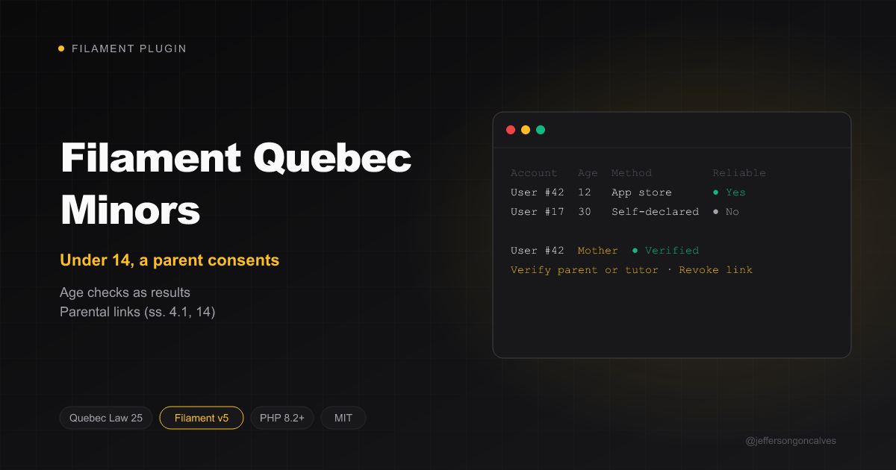

<div class="filament-hidden">



</div>

# Filament Quebec Minors

[](https://packagist.org/packages/jeffersongoncalves/filament-quebec-minors)
[](https://github.com/jeffersongoncalves/filament-quebec-minors/actions?query=workflow%3Atests+branch%3A3.x)
[](https://github.com/jeffersongoncalves/filament-quebec-minors/actions?query=workflow%3A"Fix+PHP+code+styling"+branch%3A3.x)
[](https://packagist.org/packages/jeffersongoncalves/filament-quebec-minors)
[](LICENSE.md)

Manage the minors' consent records kept by [laravel-quebec-minors](https://github.com/jeffersongoncalves/laravel-quebec-minors) in your Filament panel. Under Quebec's private sector privacy act (Law 25), information about a minor under 14 is collected and used only with the consent of the person having parental authority or the tutor (ss. 4.1 and 14).

## Features

- **Age checks:** a read-only list of each result, with the age at the check, the method (marked as reliable or not), the provider and the expiry date. Filter the users under 14. Your app's age check flow records them. Nobody types them in by hand.
- **Parental links:** link a minor's account to the person having parental authority or the tutor, then verify or revoke the link. Once verified, the minor's consent counts.
- 19 languages.

## Compatibility

| Plugin Version                                                              | Filament |
|-----------------------------------------------------------------------------|----------|
| [1.x](https://github.com/jeffersongoncalves/filament-quebec-minors/tree/1.x) | 3.x      |
| [2.x](https://github.com/jeffersongoncalves/filament-quebec-minors/tree/2.x) | 4.x      |
| [3.x](https://github.com/jeffersongoncalves/filament-quebec-minors/tree/3.x) | 5.x      |

## Installation

You can install the package via composer:

```bash
composer require jeffersongoncalves/filament-quebec-minors:"^3.0"
php artisan vendor:publish --tag="quebec-minors-migrations"
php artisan migrate
```

## Usage

```php
use JeffersonGoncalves\Filament\QuebecMinors\QuebecMinorsPlugin;

public function panel(Panel $panel): Panel
{
    return $panel
        ->plugins([
            QuebecMinorsPlugin::make()
                ->navigationGroup('Quebec')            // default: no group
                ->navigationSort(7)
                ->subjectModel(\App\Models\User::class)  // default: auth.providers.users.model
                ->subjectTitleAttribute('name'),     // shown next to the id and used to search accounts
        ]);
}
```

All fluent methods are optional.

> The resources have no authorization of their own. Register them only on panels whose users handle privacy, or add policies for the `JeffersonGoncalves\QuebecMinors\Models\*` models.

## Testing

```bash
composer test
```

## Changelog

Please see [CHANGELOG](CHANGELOG.md) for more information on what has changed recently.

## Contributing

Please see [CONTRIBUTING](.github/CONTRIBUTING.md) for details.

## Security Vulnerabilities

Please review [our security policy](../../security/policy) on how to report security vulnerabilities.

## Credits

- [Jefferson Gonçalves](https://github.com/jeffersongoncalves)
- [All Contributors](../../contributors)

## License

The MIT License (MIT). Please see [License File](LICENSE.md) for more information.
